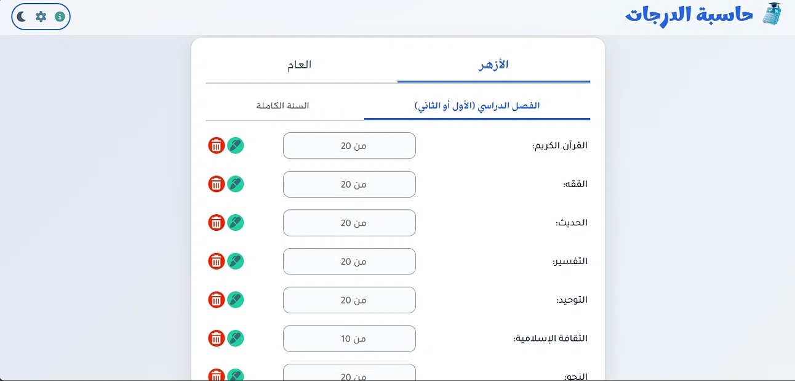
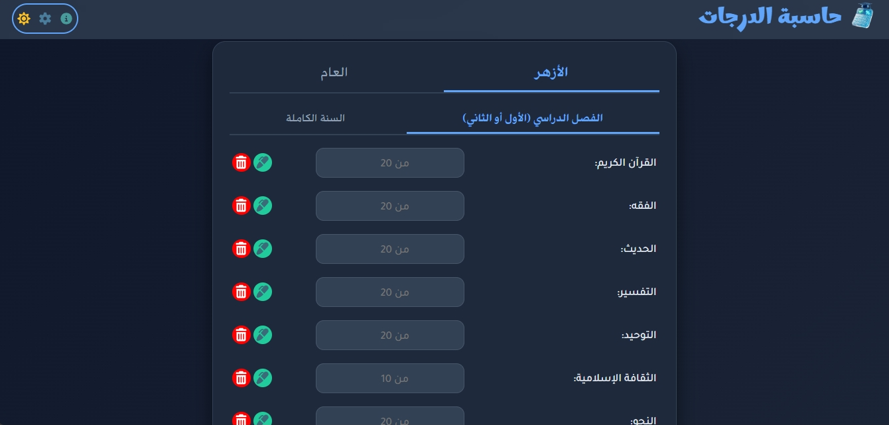

<div align="center">
  
</div>

# Grade Calculator

[](https://creativecommons.org/licenses/by-nc/4.0/)
[](https://developer.mozilla.org/en-US/docs/Web/HTML)
[](https://developer.mozilla.org/en-US/docs/Web/CSS)
[](https://developer.mozilla.org/en-US/docs/Web/JavaScript)

A smart and fast grade calculator for Azhar and General Education students in Egypt. Built with a modern UI that supports light/dark mode, image export, and table printing.

**Live Demo:** [https://sohaib-frontend1.github.io/grade-calculator/](https://sohaib-frontend1.github.io/grade-calculator/)

---

## Overview

Grade Calculator is a lightweight, client-side web application designed to help students calculate their total score, percentage, and grade estimation quickly. It supports both the General and Azhar educational systems with full subject management.

The application provides a streamlined interface for managing subjects, validating input data, and generating visual reports without the need for a backend server.

**Privacy:** No server, no database, no tracking. All user data remains in the browser.

---

## Screenshots

### Light Mode


### Dark Mode


## Key Features

### Educational Systems Support
- **General Section:** Default subjects include Arabic, English, Mathematics, Science, and Social Studies.
- **Azhar Section:** Full support for Azhar subjects including Quran, Fiqh, Hadith, Tafsir, Tawhid, Islamic Culture, Arabic branches (Nahw, Sarf, Balagha, Insha, Adab, Mutalaa), and cultural subjects. **Defaults specifically to the 1st Secondary - Scientific Section (Class of 2024/2025).**
- **Term Support:** Supports First Term, Second Term, and Full Year calculation.
- **Section Management:** Add new sections, edit the passing grade percentage, and save settings to local storage.

### Core Functionality
- **Dynamic Subject Management:** Users can add, edit, or remove subjects and define the maximum grade for each, accommodating different grading scales.
- **Instant Calculation:** Calculates total marks, percentage, and grade level (Excellent, Very Good, etc.) in real-time.
- **Data Validation:** Strictly enforces data integrity by preventing negative values and restricting input to the maximum allowable grade per subject. Calculations only execute when all required fields are correctly populated.
- **Smart Alerts:** Validation alerts for missing grades or section names.
- **Local Data Persistence:** All user data (grades, subject lists, and application settings) is securely stored in the browser's LocalStorage. No external database is required, ensuring privacy and offline accessibility.

### User Interface
- **Responsive Design:** Optimized for various screen sizes, including mobile devices, tablets, and desktop monitors using modern CSS techniques.
- **Theme Toggle:** Dynamic Dark/Light mode feature to enhance user experience and reduce eye strain.
- **Interactive Progress Bar:** Features gradient colors to visually represent the score.
- **Built-in User Guide:** Includes a dedicated help section/button providing clear instructions in Arabic for first-time users, explaining how to navigate and customize their subjects.

### Export and Sharing
- **Save Result as Image:** Export the full result card as a high-quality PNG image.
- **Save Table as Image:** Export only the grades table as a clean image, ready to share.
- **Share as Image:** Share results directly via WhatsApp, Facebook, or any app. Utilizes the Web Share API for direct sharing on supported mobile devices or automatically downloads the image on desktop platforms.
- **Print as Table:** Print a clean, organized table version of grades. Dedicated CSS media queries ensure tables and results are formatted correctly for physical printing, maintaining color accuracy and structural integrity.

---

## Color Palette

| Element | Light Mode | Dark Mode |
| :--- | :--- | :--- |
| Primary Blue | `#2563EB` | `#3B82F6` |
| Sun Icon (Dark Mode) | - | `#FBBF24` |
| Moon Icon (Light Mode) | `#334155` | - |
| Hover Background | `#F1F5F9` | `#334155` |

---

## Tech Stack

- **HTML5:** Page structure.
- **CSS3:** Advanced styling (Variables, Flexbox, Grid).
- **JavaScript (Vanilla):** No frameworks used for maximum performance and lightness.
- **LocalStorage:** For saving user settings and data.
- **html2canvas:** For exporting elements as images.
- **Window.print:** For printing tables.

---

## Folder Structure

```text
grade-calculator/
├── index.html
├── styles/
│   └── style.css
├── scripts/
│   └── script.js
└── README.md
```

---

Installation and Usage

1. Clone the repository:
   ```bash
   git clone https://github.com/sohaib-frontend1/grade-calculator.git
   ```
2. Navigate to the project folder:
   ```bash
   cd grade-calculator
   ```
3. Run the application:
   · Open index.html directly in your browser.
   · Or use the Live Server extension in VS Code for a better experience.

No dependencies or build steps required.

---

License

This project is licensed under CC BY-NC 4.0.

· Free for personal and educational use.
· Commercial use is not allowed.
